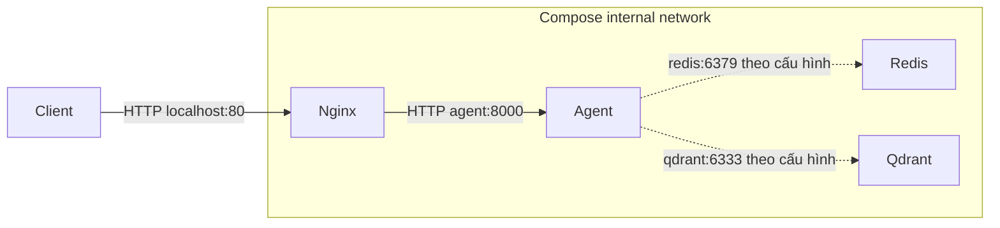

# Day 14 — Mission Answers

## Part 1 — Localhost vs Production

### Exercise 1.1 — Anti-patterns trong `01-localhost-vs-production/develop/app.py`

1. **Dòng 17–18:** API key mẫu và chuỗi kết nối DB có mật khẩu nằm trong code. Nếu dùng giá trị thật, người có quyền đọc repo hoặc image có thể lấy được, kể cả sau khi giá trị bị xóa khỏi phiên bản hiện tại.
2. **Dòng 21–22:** Debug và giới hạn token được khai báo bằng hằng số trong mã nguồn. Đổi giá trị giữa các môi trường sẽ phải sửa code.
3. **Dòng 33–38:** `print()` ghi cả key mẫu, câu hỏi và câu trả lời ra log. Cách này có thể làm lộ dữ liệu và khó lọc log theo sự kiện hoặc mức độ.
4. **Dòng 25–39:** App chỉ khai báo `/` và `/ask`. Hạ tầng thiếu endpoint riêng để phân biệt process còn sống với instance đã sẵn sàng nhận traffic.
5. **Dòng 49–53:** Bind `localhost` và cố định cổng `8000`. Kết nối từ bên ngoài container có thể thất bại, và app không theo được cổng do nền tảng cấp.
6. **Dòng 53:** `reload=True` luôn bật. Cơ chế theo dõi file và khởi động lại process phù hợp khi phát triển, có thể gây gián đoạn nếu file thay đổi lúc đang phục vụ.
7. **Dòng 13 và 49–54:** App không khai báo lifecycle hook để thu dọn tài nguyên riêng khi shutdown. Uvicorn vẫn có cơ chế dừng server mặc định.

### Exercise 1.2 — Chạy develop

Chạy `python app.py` trong `01-localhost-vs-production/develop/` bằng `.venv` trên Ubuntu WSL2. Bản này nhận `question` qua query string.

```bash
curl -X POST 'http://localhost:8000/ask?question=Hello'
```

Kết quả thực tế `HTTP 200`:

```json
{"answer":"Agent đang hoạt động tốt! (mock response) Hỏi thêm câu hỏi đi nhé."}
```

`GET /health` trên cùng app trả `HTTP 404`, xác nhận bản mẫu chưa có endpoint health riêng. Nội dung câu trả lời mock có thể thay đổi giữa các lần chạy.

### Exercise 1.3 — So sánh develop và production

| Tiêu chí | Develop | Production | Vì sao quan trọng? |
| --- | --- | --- | --- |
| Cấu hình | Key, địa chỉ DB và tham số server đặt trong code. | `config.py` đọc env tập trung, có giá trị mặc định và kiểm tra key khi `ENVIRONMENT=production`. | Có thể dùng cùng code ở nhiều môi trường. Secret được cấp lúc chạy và có thể đổi riêng. |
| Mạng và debug | `localhost:8000`, reload luôn bật. | Đọc `HOST`, `PORT`, `DEBUG`. Mặc định `0.0.0.0`, cổng 8000, reload tắt. | Proxy/container có thể truy cập đúng cổng và server không tự reload theo thay đổi file trong cấu hình mặc định. |
| Health và readiness | Chưa có probe riêng. | `/health` báo trạng thái process, `/ready` kiểm tra cờ `is_ready` và có nhánh 503. | Hạ tầng có thể dùng liveness để phát hiện lỗi process và readiness để quyết định có chuyển traffic vào instance. |
| Logging | `print()` kèm key và nội dung request/response. | Dùng `logging` với sự kiện như `agent_request` và `agent_response`, ghi độ dài thay vì nội dung câu hỏi hay key. | Có thể lọc sự kiện và giảm dữ liệu nhạy cảm đi vào log. |
| Shutdown | Dùng vòng đời mặc định của Uvicorn, chưa có hook riêng của app. | `lifespan` có phần khởi tạo và phần dọn dẹp, cờ sẵn sàng được hạ khi shutdown. | App có chỗ để giải phóng kết nối, còn Uvicorn thực hiện trình tự dừng server. |
| Dữ liệu vào | `/ask` yêu cầu tham số query `question`. | `/ask` đọc body JSON. Với `{}`, app trả 422 và thông báo `question field is required`. | Client biết gửi dữ liệu theo hợp đồng của từng phiên bản và nhận phản hồi rõ khi thiếu trường. |

**Kiểm tra thực tế:** chạy production ở `127.0.0.1:8101` với `ENVIRONMENT=staging`, `DEBUG=false`, dùng mock LLM và để trống key. `GET /health` trả 200 với `status=ok` và `environment=staging`. `GET /ready` trả 200 với `{"ready":true}`. `POST /ask` với `{"question":"Hello"}` trả 200, với `{}` trả 422. Sau SIGTERM, Uvicorn ghi `Application shutdown complete` và process thoát mã 0. Lần thử này xác nhận trình tự shutdown khi server rảnh.

**Quan sát về log:** mẫu production có khai báo định dạng log và tạo nội dung sự kiện bằng `json.dumps()`. Trong lần chạy thiếu `OPENAI_API_KEY`, cảnh báo từ `config.py` xuất hiện trước `logging.basicConfig()` của app, nên cấu hình log mặc định được khởi tạo trước. Vì vậy kết quả trên xác nhận log shutdown của Uvicorn, chưa xác nhận log JSON của app.

## Part 2 — Docker

### Exercise 2.1 — Dockerfile cơ bản

1. **Base image:** `python:3.11`, cung cấp Python 3.11 và môi trường hệ thống để cài dependencies.
2. **Working directory:** `/app`. Docker áp dụng `WORKDIR /app` cho các chỉ thị sau đó, nên `COPY ... .` ghi vào `/app` và lệnh `python app.py` chạy ở đó.
3. **COPY requirements trước:** Docker có thể dùng lại layer `pip install` khi chỉ sửa `app.py` hoặc `mock_llm.py`. Khi `requirements.txt` đổi, bước cài dependencies sẽ chạy lại.
4. **CMD và ENTRYPOINT:** `ENTRYPOINT` đặt chương trình mà container khởi động, còn `CMD` đặt lệnh mặc định hoặc đối số mặc định cho `ENTRYPOINT`. Đối số sau tên image trong `docker run` thay phần `CMD` mặc định. Dùng `--entrypoint` để đổi `ENTRYPOINT`. Dockerfile develop đặt `CMD ["python", "app.py"]`.

### Exercise 2.2 — Build và chạy develop

Từ gốc repo, dùng `docker build -f 02-docker/develop/Dockerfile -t my-agent:develop .` vì các đường dẫn `COPY` tính từ build context. Container chạy với ánh xạ cổng `8000:8000`. Bản này nhận câu hỏi qua query string.

```bash
curl -i -X POST 'http://127.0.0.1:8000/ask?question=What%20is%20Docker%3F'
```

Kết quả thực tế là `HTTP/1.1 200 OK`, với body `{"answer":"Container là cách đóng gói app để chạy ở mọi nơi. Build once, run anywhere!"}`.

### Exercise 2.3 — Multi-stage build và kích thước

- **`builder`:** dùng `python:3.11-slim`, cài `gcc`, `libpq-dev` và dependencies Python vào `/root/.local`.
- **`runtime`:** bắt đầu từ một base `python:3.11-slim` mới, chép dependencies và mã app. Chạy bằng `appuser`, có `HEALTHCHECK` và dùng hai Uvicorn worker. Bộ công cụ build nằm trong stage `builder`, nên các layer của bộ công cụ đó không xuất hiện trong image cuối.

Đo trên Docker Desktop qua Ubuntu WSL2 bằng `docker images my-agent`. Cột `DISK USAGE` được dùng để so sánh.

| Image | Disk usage | Content size |
| --- | ---: | ---: |
| `my-agent:develop` | 1,67 GB | 426 MB |
| `my-agent:advanced` | 240 MB | 57,4 MB |

Dùng số byte từ `docker image inspect` để tránh sai số làm tròn: `(1.667.788.183 − 239.819.428) / 1.667.788.183 × 100% = 85,62%` giảm dung lượng.

### Exercise 2.4 — Compose qua Nginx



Nginx là cổng vào từ host và chuyển request đến agent theo tên service trên mạng Compose. Compose đợi Redis và Qdrant healthy trước khi start agent. Hai biến `REDIS_URL` và `QDRANT_URL` chỉ cấu hình đích kết nối. Mẫu `/ask` gọi mock LLM trực tiếp, nên phản hồi 200 qua Nginx chỉ xác nhận luồng HTTP đến agent.

**Kết quả thực tế:** stack `k5-day14-docker` chạy đủ bốn service. `docker compose ps` báo agent, Redis và Qdrant `healthy`, Nginx `Up`. Redis trả `PONG` khi gọi `redis-cli ping` trong container.

| Request qua Nginx | Kết quả |
| --- | --- |
| `GET http://127.0.0.1/health` | `HTTP/1.1 200 OK`, `Server: nginx`, body có `status: ok` và `version: 2.0.0`. |
| `POST http://127.0.0.1/ask` với JSON `{"question":"Explain microservices"}` | `HTTP/1.1 200 OK`, `Server: nginx`, body có `answer` từ mock LLM. |

Compose v5 cảnh báo trường `version` đã lỗi thời và vẫn khởi động stack thành công. Sau khi kiểm tra đã chạy `docker compose -p k5-day14-docker down -v` trong ngữ cảnh Compose của CP2.

## Part 3 — Cloud Deployment

### Exercise 3.1–3.2 — Railway và Render

Render được chọn cho agent Part 6. `06-lab-complete/render.yaml` dùng `runtime: docker`, xác định thư mục gốc của service, kiểm `/health`, sinh `AGENT_API_KEY` và tham chiếu URL nội bộ của Render Key Value. `06-lab-complete/railway.toml` là cấu hình tương đương cho Railway với builder `DOCKERFILE` và `healthcheckPath`. Railway đặt secret và tham chiếu Redis trong biến môi trường của service. Cả hai cấu hình dùng Dockerfile để khởi động Uvicorn theo `PORT`.

Render báo triển khai thành công (`Live`) cho commit `be98ae7`. URL public là [k5-day14-hoang-agent.onrender.com](https://k5-day14-hoang-agent.onrender.com). Xem kết quả từng phép thử trong [DEPLOYMENT.md](DEPLOYMENT.md).

Bốn phép thử HTTPS public lần lượt trả `200` cho `/health`, `200` cho `/ready`, `401` cho `/ask` thiếu key và `200` cho `/ask` có key hợp lệ. Ảnh Blueprint, ảnh trạng thái Live và ảnh phép thử đã lưu trong `screenshots/`.

### Exercise 3.3 — Đọc pipeline Cloud Run

1. `cloudbuild.yaml` chạy `pytest` trước khi build. Bước build gắn hai tag cho image, theo `$COMMIT_SHA` và `latest`.
2. Pipeline push hai tag vào registry, sau đó dùng `gcloud run deploy` để chạy image theo commit ở `asia-southeast1`.
3. `service.yaml` là cấu hình Cloud Run riêng. Nó khai báo cổng 8000, readiness khi khởi động qua `/ready`, liveness qua `/health` và lấy secret từ Secret Manager.
4. `service.yaml` đặt mức scale 1–10 instance và tối đa 80 request đồng thời mỗi container. Bước `gcloud run deploy` trong `cloudbuild.yaml` truyền các cờ CLI riêng và không áp dụng trực tiếp file YAML đó.

## Part 4 — API Security

### Exercise 4.1 — API key

`develop/app.py` đọc `AGENT_API_KEY` từ môi trường. Dependency `verify_api_key` lấy header `X-API-Key` và kiểm tra trước khi `/ask` gọi mock LLM. Để rotate, cập nhật env, khởi động lại service và cập nhật key cho client. Bản demo in key khi khởi động, nên bỏ dòng đó nếu dùng key thật.

Output `curl -i` trên Ubuntu WSL2, rút gọn header và che key:

```text
POST /ask — thiếu X-API-Key
HTTP/1.1 401 Unauthorized
{"detail":"Missing API key. Include header: X-API-Key: <your-key>"}

POST /ask — key sai
HTTP/1.1 403 Forbidden
{"detail":"Invalid API key."}

POST /ask — key đúng
HTTP/1.1 200 OK
{"question":"Hello","answer":"Tôi là AI agent được deploy lên cloud. Câu hỏi của bạn đã được nhận."}
```

### Exercise 4.2 — JWT

Gửi tài khoản demo `student` đến `POST /auth/token`. `auth.py` xác thực tài khoản rồi ký JWT bằng HS256. Token có `sub`, `role`, `iat`, `exp` và hết hạn sau 60 phút. Khi gọi `POST /ask`, client gửi `Authorization: Bearer <token>`. Server kiểm chữ ký và thời hạn trước khi dùng `sub` và `role` để chọn bộ giới hạn.

```text
POST /auth/token — tài khoản student
HTTP/1.1 200 OK
{"access_token":"[đã che]","token_type":"bearer","expires_in_minutes":60}

POST /ask — thiếu JWT
HTTP/1.1 401 Unauthorized
www-authenticate: Bearer

POST /ask — gửi JWT hợp lệ
HTTP/1.1 200 OK
```

### Exercise 4.3 — Rate limiting

`rate_limiter.py` dùng sliding window theo username. Mỗi lần gọi, bộ giới hạn loại timestamp đã ra khỏi cửa sổ 60 giây, đếm các request còn lại và tính thời gian có thể thử lại nếu hết lượt. User được 10 request/phút. Role admin dùng bộ giới hạn 100 request/phút và vẫn bị giới hạn. Bản mẫu lưu state trong bộ nhớ process.

Sau một request JWT thành công ở Exercise 4.2, gọi liên tiếp thêm 20 request bằng cùng token. Vòng lặp có **9 lượt 200 và 11 lượt 429**. Lượt 429 đầu tiên là request thứ 10 trong vòng lặp, tương ứng request thứ 11 tính cả lượt kiểm tra JWT trước đó.

```text
HTTP/1.1 429 Too Many Requests
retry-after: 59
{"detail":{"error":"Rate limit exceeded","limit":10,"window_seconds":60,"retry_after_seconds":59}}
```

### Exercise 4.4 — Cost guard

- **Mẫu hiện tại:** `/ask` kiểm ngân sách trước khi gọi LLM, sau đó ghi input/output token, số lượt và chi phí ước tính. Ngưỡng mỗi user là 1 USD/ngày, cảnh báo ở 80% và trả 402 khi chạm ngưỡng. Ngưỡng toàn cục là 10 USD, khi chạm ngưỡng trả 503. `GET /me/usage` thực tế trả 200 với 10 lượt, `cost_usd=0.000176` và `budget_remaining_usd=0.999824` (chi phí mock). Kiểm tra trực tiếp lớp `CostGuard` bằng dữ liệu token giả lập xác nhận cả hai nhánh 402 (user) và 503 (toàn cục).
- **Phương án 10 USD/tháng cho mỗi user:** dùng key Redis `budget:{user_id}:{YYYY-MM}` theo UTC. Lưu chi phí bằng số nguyên micro-USD. Trước khi gọi LLM, dùng thao tác nguyên tử để so sánh tổng hiện tại cộng chi phí dự kiến với hạn mức. Nếu vượt thì trả 402, nếu còn ngân sách thì giữ chỗ và đặt TTL dọn key kỳ cũ. Khi vào tháng mới, key mới mặc định có tổng bằng 0. Sau khi gọi, đối soát chi phí thực tế và hoàn lại phần giữ chỗ dư hoặc giải phóng giữ chỗ nếu lời gọi thất bại. Cập nhật nguyên tử giúp các worker cùng đọc và ghi một ngân sách mà không đồng thời vượt hạn mức dự kiến.
- **Giới hạn mẫu:** bộ đếm toàn cục `_global_cost` chưa có logic reset theo ngày. Ngoài ra, `budget_remaining_usd` trong response `/ask` đang lấy số tiền đã dùng. Số tiền còn lại ở trên lấy từ `/me/usage`, nơi thực hiện phép trừ hạn mức với chi phí đã dùng.

## Part 5 — Scaling & Reliability

### Exercise 5.1 — Health và readiness

`GET /health` cho biết process còn phản hồi. `GET /ready` cho biết replica có sẵn sàng nhận traffic. Khi app đã khởi động với Redis, readiness gọi `PING` và trả 503 nếu ping lỗi. Nếu Redis vắng ngay lúc khởi động, mẫu chuyển sang bộ nhớ trong process và `/ready` vẫn trả 200. Chế độ fallback này chỉ phù hợp cho demo một instance.

Qua `http://localhost:8080`, `/health` trả `200` với `status=ok`, `storage=redis`, `redis_connected=true`. `/ready` trả `200` với `ready=true`. Sau khi dừng Redis, `/health` vẫn trả `200` với `status=degraded` và `redis_connected=false`. Lần gọi `/ready` qua Nginx hết thời gian chờ 10 giây. Cấu hình mẫu cho phép Nginx thử upstream khác khi gặp 503, nên thời gian phản hồi qua proxy có thể khác khi gọi thẳng agent.

Lần kiểm tra trực tiếp bên trong replica, bỏ qua Nginx, ghi nhận `/ready` trả `503` với `{"detail":"Redis not available"}` sau khoảng 4,01 giây.

### Exercise 5.2 — Graceful shutdown

Container chạy Uvicorn làm process chính. Khi nhận SIGTERM, Uvicorn ngừng nhận kết nối mới, chờ request đang chạy và thực hiện phần shutdown trong FastAPI `lifespan`. Mẫu ghi log khi instance dừng. Nếu app tự mở các kết nối dài hạn, phần shutdown là nơi để đóng chúng. Phép kiểm tra dừng replica ở đây được thực hiện khi server rảnh.

Khi chạy `docker compose -p k5-day14-scaling stop agent`, cả ba replica ghi `Application shutdown complete.` và có trạng thái `Exited (0)`. Sau đó stack được dọn bằng `docker compose -p k5-day14-scaling down`.

### Exercise 5.3 — Session dùng chung

Dictionary trong RAM thuộc riêng từng process. Với load balancing, request sau có thể gặp replica không có history từ request trước. Bản dùng Redis đọc và ghi cùng key `session:<session_id>`, dùng TTL 3.600 giây và giữ tối đa 20 tin nhắn. Nhờ vậy replica nào cũng có thể đọc cùng session. Mẫu dùng đọc–sửa–ghi trên JSON, nên các cập nhật đồng thời cho cùng session vẫn có thể ghi đè nhau. Bài test bên dưới gửi tuần tự.

### Exercise 5.4 — Load balancing với ba replica

Chạy `docker compose -p k5-day14-scaling up -d --build --scale agent=3` trong `05-scaling-reliability/production/`. `docker compose ps` ghi nhận cả ba replica agent và Redis `healthy`, Nginx `Up`. Client gọi cổng `8080`, Nginx chuyển tiếp đến `agent:8000`. Header `X-Served-By` chứa địa chỉ upstream, còn trường `served_by` trong JSON của `/chat` chứa ID instance. Năm request trong lần thử lần lượt đến `instance-ee0884`, `instance-63e442`, `instance-a2e1ae`, `instance-ee0884`, `instance-63e442`.

### Exercise 5.5 — Kiểm tra stateless

Chạy `python test_stateless.py` bằng `.venv` trên Ubuntu WSL2. Trích output thực tế:

```text
Total requests: 5
Instances used: {'instance-a2e1ae', 'instance-ee0884', 'instance-63e442'}
--- Conversation History ---
Total messages: 10
✅ Session history preserved across all instances via Redis!
```

Năm câu hỏi và năm câu trả lời xuất hiện trong cùng history dù ba instance cùng phục vụ. Script gửi request và đọc history, không tự dừng replica. Kết quả xác nhận chia sẻ session qua Redis trong bài đo tuần tự.

## Part 6 — Checklist Deliverable

Chạy bộ chấm đầy đủ từ `06-lab-complete/` bằng Python 3.11.18 trong Ubuntu WSL2 và Docker 29.9.3. Trích output:

```text
  📋 Checklist Deliverable
     ✅ Dockerfile (multi-stage, < 500 MB)
     ✅ docker-compose.yml (agent + redis)
     ✅ .dockerignore
     ✅ Health check endpoint (GET /health)
     ✅ Readiness endpoint (GET /ready)
     ✅ API Key authentication
     ✅ Rate limiting
     ✅ Cost guard
     ✅ Config từ environment variables
     ✅ Structured logging
     ✅ Graceful shutdown
     ✅ Public URL ready (Railway / Render config)
----------------------------------------------------------------
  Result: 12/12 tiêu chí đạt · 41/41 checks passed
  🎉 PASS 12/12 — PRODUCTION READY! Deploy nào!
```

- Bộ chấm đo image **273 MB**. Container khởi động khi chưa có Redis. Khi gửi SIGTERM giữa lúc có request, request vẫn trả 200 và process thoát mã 0. `docker stop` mất **0,7 giây** và container thoát mã 0.
- Chạy thêm Compose ở `PORT=8106` với hai worker. 15 request đồng thời dùng cùng key nhận **10 lượt 200 và 5 lượt 429**, có `Retry-After`. Khi dừng Redis, `/health` trả 200 và `/ready` trả 503. Stack thử nghiệm đã được dọn.
- Bộ giới hạn dùng cửa sổ trượt nguyên tử trong Redis. Cost guard kiểm chi phí đã tích lũy trước khi gọi mock LLM và ghi chi phí sau khi nhận kết quả. Các lượt đã qua bước kiểm tra có thể làm tổng vượt ngưỡng khi chạy đồng thời. Hạn mức mặc định là 10 USD/tháng theo UTC.
- Chuẩn bị cấu hình Railway ở CP5 và triển khai trên Render ở CP6 theo lựa chọn của học viên. Base image là bản sao Docker Official Image `python:3.11-slim` trên ECR Public, có cùng manifest digest với bản dùng trước đó. Docker Hub trả HTTP 429 trong lần build đầu.

## AI log

Các mục dưới đây tóm tắt gợi ý nhận được từ Codex. Codex cũng hỗ trợ soạn hướng dẫn, chỉnh mã và chạy các phép kiểm tra được ghi trong bài. Phần học viên tự thực hiện đã xác nhận được ghi ở CP6 và CP8.

| Mục học viên hỏi | Gợi ý của Codex | Kết quả kiểm tra |
|---|---|---|
| CP0 · Chuẩn bị lab | Chia đề theo checkpoint và kiểm tra môi trường trước khi chạy. | Hướng dẫn nằm trong `checkpooint.md`. |
| CP1 · Localhost và production | So sánh cấu hình hai bản app, thử `/health`, `/ready` và quan sát khi gửi SIGTERM. | Part 1 ghi mã HTTP và kết quả shutdown. |
| CP2 · Docker | So sánh kích thước hai image và kiểm tra đường đi của request qua Nginx. | Part 2 ghi kích thước image và phản hồi HTTP. |
| CP3 · Bảo vệ API | Thử trường hợp thiếu key, có key và vượt rate limit. Đối chiếu cách cost guard tính hạn mức với mã nguồn. | Part 4 ghi các mã `401`, `200`, `429` và kết quả kiểm tra ngân sách. |
| CP4 · Scaling và reliability | Kiểm tra nhiều replica, đối chiếu `/health` và `/ready` khi dừng Redis, rồi kiểm tra state dùng chung. | Part 5 ghi kết quả qua Nginx và khi gọi thẳng agent. |
| CP5 · Hoàn thiện agent Part 6 | Dùng Redis cho state dùng chung, cấu hình qua biến môi trường và chạy `check_production_ready.py` với Docker. | Lượt chấm đầy đủ đạt 12/12 tiêu chí. |
| CP6 · Deploy trên Render | Dùng Blueprint cho web service và Key Value. Kiểm tra `/health`, `/ready` và hai trường hợp gọi `/ask`. | `DEPLOYMENT.md` ghi URL và bốn kết quả HTTP. |
| CP7 · Benchmark local | Đo theo nhiều mức concurrency, dùng eval v1 và v2 để xác định câu sai, rồi bổ sung knowledge base và chạy lại quality gate. | `eval_v2_fixed.json` ghi 23/23 câu đúng và 0 regression. |
| CP8 · Observability và scaling | Chạy Locust ở 1 và 3 replica, dùng Grafana và Prometheus để theo dõi thay đổi, rồi đối chiếu trace Jaeger với log qua `trace_id`. | Hai CSV ghi p95 là 240 ms và 220 ms. Ảnh Prometheus ghi hai cảnh báo cùng firing. |

- **CP6 · Phần học viên thực hiện** — Tôi chọn Render, đăng nhập dashboard và cho phép push mã Part 6 lên nhánh triển khai riêng.
- **CP8 · Phần học viên thực hiện** — Tôi yêu cầu rà soát bộ bài và chọn hoàn thiện hồ sơ trên máy.
